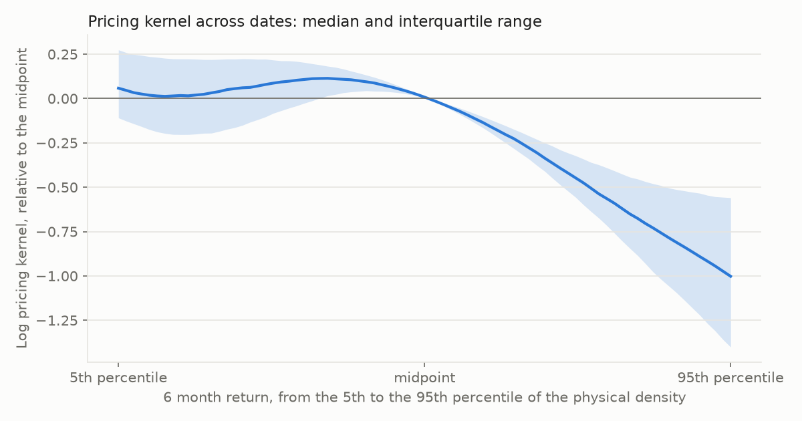
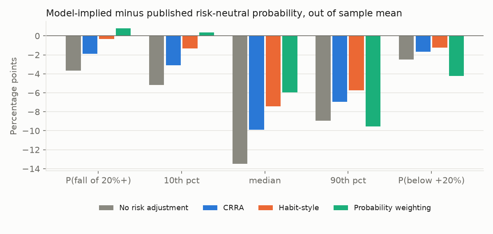

# Behavioral Pricing Kernel

**Question.** Option prices imply one set of probabilities for the S&P 500 and history implies another. The ratio of the two is the pricing kernel. Does a behavioral model, in which investors overweight unlikely outcomes, explain that ratio better than standard risk aversion, and does the size of the distortion move with sentiment or predict returns?

<!-- headline:start (generated by python -m bpk.study.render, do not edit by hand) -->
**Answer, on 815 real option-implied densities from 2007 to 2026: not by the tests set in advance.** All four pre-registered hypotheses fail. One finding survives those tests. Probability weighting fits the gap between market-implied and realistic probabilities better out of sample than standard risk aversion (average error 7.2 against 7.8 percentage points, t = 4.5), and the estimated distortion overweights tail events on 96% of dates. But it does not clearly beat a habit-style benchmark (p = 0.12), so the first hypothesis fails its own pre-registered test at the main horizon. A later check that was not pre-registered shows this rests on the assumed realistic distribution: across 5 reasonable choices of it, weighting beats CRRA at 5 percent in only 2, while the distortion still overweights tails on most dates in 5 ([results/real/physical_robustness.md](results/real/physical_robustness.md)). The distortion does not rise with investor sentiment (t = -1.5, wrong sign), it does not predict returns out of sample (R squared gain 0.8%, p = 0.32), and trading on it loses to buy and hold. No model fits well in absolute terms: the best one still misses by 7.2 percentage points of probability on average.
<!-- headline:end -->

The hypotheses, the data and every test were written down before any estimation ([docs/hypotheses.md](docs/hypotheses.md), Amendment 3, committed first). The verdicts below are computed by code from those rules, and CI fails if this page drifts from the results file.

The picture is the pricing kernel puzzle on real data. Standard theory says the kernel should fall steadily from left to right: bad outcomes are expensive to insure, good ones cheap. Over losses it is flat or rising instead, and only over gains does it fall.

## Results

<!-- results:start (generated by python -m bpk.study.render, do not edit by hand) -->
| Hypothesis | Pre-registered test | Verdict |
|---|---|---|
| H1 | Probability weighting beats CRRA and habit-style out of sample (Diebold-Mariano, 5%) | **Not supported.** Beats CRRA out of sample but not the habit-style model at 5 percent; beats both at 12 months. |
| H2 | Distortion rises with lagged sentiment, significant and stable in both halves | **Not supported.** Slope is negative and not significant. |
| H3 | Distortion predicts next month's return out of sample beyond the variance risk premium | **Not supported.** No significant out-of-sample gain over the variance risk premium. |
| H4 | A timing strategy on that forecast beats buy and hold after costs | **Not supported.** Does not beat buy and hold after costs. |

Sample: 815 dates at 6 months and 813 at 12 months, 2007-01-12 to 2026-09-30. Parameters are re-estimated each January on earlier dates only; out of sample means 2012 onward. Errors are root mean squared gaps between model-implied and published risk-neutral probabilities at five points, in percentage points.

**Model fit, 6 month horizon** (695 out-of-sample dates)

| Model | Parameters | In-sample error | Out-of-sample error | Full-sample estimate |
|---|---|---|---|---|
| No risk adjustment | 0 | 8.4 | 8.4 | n/a |
| CRRA | 1 | 7.3 | 7.8 | 0.64 |
| Habit-style | 2 | 6.3 | 8.3 | 1.15, -2.87 |
| Probability weighting | 2 | 6.7 | 7.2 | 0.45, 0.83 |
| Probability weighting with sentiment | 3 | 6.7 | 7.2 | 0.47, 0.83, -0.07 |

**Model fit, 12 month horizon** (693 out-of-sample dates)

| Model | Parameters | In-sample error | Out-of-sample error | Full-sample estimate |
|---|---|---|---|---|
| No risk adjustment | 0 | 12.9 | 12.9 | n/a |
| CRRA | 1 | 11.3 | 11.4 | 0.63 |
| Habit-style | 2 | 10.7 | 11.5 | 0.96, -3.16 |
| Probability weighting | 2 | 10.5 | 10.6 | 0.42, 0.76 |

Estimates are gamma for CRRA; gamma0, gamma1 for habit-style; gamma, alpha for probability weighting; gamma, alpha0, delta with sentiment. The sentiment model is scored on the dates with sentiment data, so its errors are not on the same sample.

**Diebold-Mariano tests on out-of-sample losses** (Newey-West, 26 lags; positive t favours the first model)

| Comparison | Horizon | t | One-sided p | Dates |
|---|---|---|---|---|
| Probability weighting vs CRRA | 6 months | 4.51 | 0.000 | 695 |
| Probability weighting vs habit-style | 6 months | 1.15 | 0.124 | 695 |
| CRRA vs no risk adjustment | 6 months | 1.15 | 0.126 | 695 |
| Adding sentiment vs probability weighting | 6 months | 0.21 | 0.416 | 656 |
| Probability weighting vs CRRA | 12 months | 6.39 | 0.000 | 693 |
| Probability weighting vs habit-style | 12 months | 1.87 | 0.031 | 693 |
| CRRA vs no risk adjustment | 12 months | 4.23 | 0.000 | 693 |

**Where each model misses** (6 months, out of sample): mean model-implied minus published probability, percentage points

| Model | P(fall of 20%+) | 10th percentile | Median | 90th percentile | P(below +20%) |
|---|---|---|---|---|---|
| No risk adjustment | -3.6 | -5.2 | -13.5 | -8.9 | -2.5 |
| CRRA | -1.9 | -3.1 | -9.9 | -6.9 | -1.7 |
| Habit-style | -0.3 | -1.3 | -7.4 | -5.7 | -1.2 |
| Probability weighting | +0.8 | +0.3 | -6.0 | -9.5 | -4.2 |

**The distortion.** Estimated date by date, the Prelec parameter alpha has median 0.80 (10th to 90th percentile 0.72 to 0.92) and is below one, meaning tails are overweighted, on 96% of dates. The reconstructed pricing kernel rises somewhere between the 5th and 95th percentile on 98% of dates. The two-normal reconstruction reproduces the published probabilities to within 0.6 percentage points at the median date.

**H2, sentiment.** Regressing month-end curvature (1 - alpha) on lagged Baker-Wurgler sentiment over 228 months (2007-01 to 2026-01) gives a slope of -0.022 (Newey-West t = -1.51); -0.062 in the first half and 0.001 in the second. High-sentiment months minus the rest: -0.019 (t = -1.09). The secondary measure, upward variation of the log kernel, has slope -0.043 (t = -1.74).

**H3, return prediction.** 176 out-of-sample months (2012-01 to 2026-08; the stated threshold was 120).

| Forecast | Benchmark | Out-of-sample R squared | Clark-West p |
|---|---|---|---|
| Variance risk premium + curvature | Variance risk premium | 0.8% | 0.32 |
| Variance risk premium + curvature | Historical mean | -31.9% | 0.89 |
| Curvature | Historical mean | -7.8% | 0.73 |
| Variance risk premium | Historical mean | -33.0% | 0.88 |

Placebo: 8.1% of 1000 shuffles of the curvature series do at least as well as the real one in the first row.

**H4, timing.** Over 176 months the strategy has a Sharpe ratio of 0.65 after costs against 0.91 for buy and hold (t of the difference in mean return -1.92), with an average market weight of 0.91 and turnover of 5.7 times a year. Its Deflated Sharpe Ratio is 0.93 with 40 logged trials; that statistic asks whether the Sharpe ratio is above 0.21, not whether it beats holding the market.
<!-- results:end -->

## Reading the results

**Probability weighting is the best of a weak field.** It has the lowest out-of-sample error at both horizons and beats CRRA decisively. The gain over CRRA comes from the left tail, where it matches the probability of a large fall and the 10th percentile closely.

**It fails where its shape is wrong.** The Prelec function overweights both tails. The market overweights only the left one. So the model pays for its left-tail fit with a worse right tail than CRRA, as the last two columns of the table of misses show. The data ask for crash aversion, a one-sided distortion, more than for the symmetric inverse-S of prospect theory. That is the most useful finding here, and it says what the next model should look like.

**The habit-style benchmark is not really a habit model.** Its second coefficient is negative, so its risk aversion falls after drawdowns, the opposite of habit formation. The term fits in sample by soaking up the volatility forecast after crashes and gives most of that back out of sample. It still blocks the first hypothesis under the rule written in advance, and the rule stands.

**Even standard risk aversion barely helps.** At six months CRRA is not significantly better than no risk adjustment at all, and the estimated risk aversion is below one. The difference between the two densities is mostly in shape, which a single slope parameter cannot move.

**Sentiment and prediction: nothing.** The distortion is, if anything, lower when sentiment is high, the opposite of the hypothesis and not significant. It adds no reliable out-of-sample forecasting power beyond the variance risk premium, and a strategy built on it trails buy and hold. These are clean failures of H2 to H4, not near misses.

**Every model misses the middle.** All four put too little probability below the published median. The option-implied density is strongly left-skewed at six months, the simulated physical density is not, and no monotone or tail-weighting adjustment turns one into the other. Some of that gap is the physical model, which is the main limitation below.

## Method

| Step | What is done |
|---|---|
| Risk-neutral side | Statistics of the option-implied density of the S&P 500 at 6 and 12 months, published by the Federal Reserve Bank of Minneapolis since 2007: four moments, three percentiles and the probabilities of a 20 percent fall and rise. |
| Physical side | GJR-GARCH with filtered historical simulation on daily market returns, 5000 paths per date. Parameters use data to the end of the previous year; the forecast uses returns to the day before. |
| Models | The pricing kernel reweights the simulated physical outcomes. No risk adjustment; CRRA; habit-style (risk aversion linear in the drawdown from the five year high); probability weighting (CRRA times the Prelec weighting derivative at the outcome's physical rank); the same with the weighting parameter linear in sentiment. |
| Loss | Mean squared gap between the model-implied and the published risk-neutral distribution function at the five published points. No density smoothing is needed on either side. |
| Estimation | Pooled parameters, expanding window, re-estimated each January. Out of sample from 2012. |
| Tests | Diebold-Mariano with Newey-West errors for fit; Newey-West regression for sentiment; Campbell-Thompson R squared, Clark-West and a shuffle placebo for prediction; Deflated Sharpe Ratio for the strategy. |

## Pre-registration

[docs/hypotheses.md](docs/hypotheses.md) holds the original hypotheses and three dated amendments, each added without editing what came before. Amendment 3 moved the study from a forward-collected option snapshot series, which would have taken years to become testable, to the published density statistics. It was committed together with the frozen data and before the first estimation; the commit history shows the order. Every specification that was run is a row in `results/results_log.csv`, and the Deflated Sharpe Ratio counts all of them as trials.

## What this cannot show

- The physical density is a model forecast, so each result is a joint test of that model and the pricing kernel. A different volatility model or equity premium would move the estimates.
- The published statistics embed the Minneapolis Fed's own smoothing and tail method. Five points and four moments cannot resolve fine structure near the current price.
- The horizon is 6 and 12 months, not the 30 days of most of the literature, because that is what is published.
- Daily market returns from the Ken French library stand in for the S&P 500.
- Sentiment rests on one proxy. The AAII survey could not be downloaded, and the Baker-Wurgler index is built with full-sample information.
- The sample has two crises. Consecutive weekly densities overlap heavily, which the Newey-West errors only partly address.
- The secondary non-monotonicity measure uses a kernel density estimate and is noisy in the tails.

[docs/limitations.md](docs/limitations.md) has the full list.

## Also in this repository

The original plan was to extract risk-neutral densities from option chains directly. That code is complete and tested: arbitrage filters, three extraction methods with tail extensions, and a grading harness against a Heston simulator with known answers (`src/bpk/rnd`, `src/bpk/synthetic`, `make rnd`). A collector for CBOE delayed quotes is in `scripts/`. None of it feeds the results above. It is kept as the method for a cross-check once a collected series is long enough.

## Reproduce

    make setup
    make test          # 108 tests
    make study         # about 25 minutes; rewrites results/real and this page
    make check         # confirms this page matches results/real/metrics.json

`make study-fast` runs a thinned version in under two minutes. `make refresh-data` downloads the series again; the sources revise history, so refreshed numbers can differ.

## Layout

    src/bpk/data/real.py        free data sources and the frozen snapshot
    src/bpk/physical/fhs.py     GJR-GARCH and filtered historical simulation
    src/bpk/kernel/             density reconstruction and the empirical pricing kernel
    src/bpk/models/             probability weighting functions
    src/bpk/estimation/sdf.py   the models, the loss, walk-forward estimation
    src/bpk/predict/            out-of-sample prediction tests
    src/bpk/backtest/           timing strategy and Deflated Sharpe Ratio
    src/bpk/study/              run.py writes results/real, render.py writes this page
    src/bpk/rnd, synthetic      option-chain extraction and its simulator
    data/real/                  frozen data with source URLs and hashes
    docs/                       hypotheses and amendments, limitations, decision records
    results/                    metrics, series, figures, results log

## References

- Ait-Sahalia, Y. and Lo, A. (2000). Nonparametric risk management and implied risk aversion. *Journal of Econometrics* 94.
- Bailey, D. and Lopez de Prado, M. (2014). The deflated Sharpe ratio. *Journal of Portfolio Management* 40(5).
- Baker, M. and Wurgler, J. (2006). Investor sentiment and the cross-section of stock returns. *Journal of Finance* 61(4).
- Barone-Adesi, G., Engle, R. and Mancini, L. (2008). A GARCH option pricing model with filtered historical simulation. *Review of Financial Studies* 21(3).
- Campbell, J. and Thompson, S. (2008). Predicting excess stock returns out of sample. *Review of Financial Studies* 21(4).
- Clark, T. and West, K. (2007). Approximately normal tests for equal predictive accuracy in nested models. *Journal of Econometrics* 138.
- Jackwerth, J. (2000). Recovering risk aversion from option prices and realized returns. *Review of Financial Studies* 13(2).
- Polkovnichenko, V. and Zhao, F. (2013). Probability weighting functions implied in options prices. *Journal of Financial Economics* 107(3).
- Prelec, D. (1998). The probability weighting function. *Econometrica* 66(3).
- Rosenberg, J. and Engle, R. (2002). Empirical pricing kernels. *Journal of Financial Economics* 64(3).

Citation metadata is in `CITATION.cff`.
